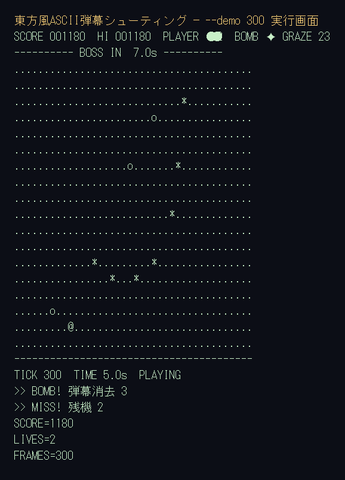

# 弾幕演習 ～ Eastern ASCII Danmaku


東方Project風の弾幕シューティングを、ターミナル（ASCIIアート）で遊べるようにした作品です。
Pythonの標準ライブラリだけで動作し、追加ライブラリのインストールは不要です。**Windows / Linux / macOS** で同じように遊べます。

## ゲームの概要

自機（`@`）を操作し、画面を流れてくる敵や弾幕をかわしながら撃ち落とす、縦スクロール風の弾幕シューティングです。
一定時間ごとにボスが出現し、HPとスペルカード名が画面に表示されます。ボスを撃破するとスコアが加算されます。

- 自機の被弾判定は**ごく小さな1文字分の点**だけ。見た目より当たりにくく、弾の隙間を縫って進めます。
- 弾に近づくとかすり（**グレイズ**）が発生し、スコアが加算されます。
- ピンチでは**ボム**で全弾を消し、一定時間無敵になれます。
- **ハイスコア**は `highscore.json` に保存され、次回起動時に読み込まれます。

## 動作環境

| 項目 | 内容 |
|---|---|
| OS | **Windows 11 / Linux / macOS**（Windows 11 実機で動作確認。Linux は CI（Ubuntu）でテストとデモ実行を確認） |
| Python | 3.10 以上（Windows 11 で 3.14 を使用） |
| 必要なライブラリ | ゲーム本体は**標準ライブラリのみ**。入力の快適さのため **`pynput`（任意）** を推奨 |
| 端末 | キー入力できるターミナル（PowerShell / Windows Terminal / bash / zsh / VS Code 統合ターミナル）。ANSIエスケープに対応した等幅フォント推奨 |

キー入力は環境に応じて自動で切り替わります。

| 環境 | 入力方式 |
|---|---|
| Windows | `msvcrt`（標準ライブラリ） |
| Linux / macOS | `termios` + `tty` + `select`（標準ライブラリ） |

キー入力を取得できない環境（パイプ実行・CI など）では、自動でデモモードに切り替わります。

## インストール方法

ゲーム本体は**Python 3.10 以上**があれば動きます。追加のインストールは必須ではありません。

```powershell
git clone https://github.com/yuki-kanemaru/touhou-ascii-danmaku.git
cd touhou-ascii-danmaku
```

### 操作を快適にする（推奨・任意）

`pynput` を入れると、キーの**押しっぱなし**・**斜め移動**・**Shift（低速移動）**が正しく効くようになります。
入れなくても動きますが、その場合はOSのキーリピート頼みになります。

```bash
python -m pip install -r requirements.txt
```

#### `No module named pip` と出る場合（Debian/Ubuntu のシステムPythonなど）

`/usr/bin/python: No module named pip` は、**その Python に pip が入っていない**だけです（Debian/Ubuntu は pip を別パッケージに分けているため）。システムPythonを直接いじらず、**仮想環境（venv）を作るのが安全**です。

```bash
python3 -m venv .venv
source .venv/bin/activate      # Windows は .venv\Scripts\activate
python -m pip install -r requirements.txt
python touhou_like.py
```

`python3-venv` が無い場合は先に入れます。

```bash
sudo apt update && sudo apt install -y python3-venv python3-pip
```

pip を使わずに `uv` で実行する方法もあります。

```bash
curl -LsSf https://astral.sh/uv/install.sh | sh
uv run --with pynput python touhou_like.py
```

> `pynput` が入らなくても**ゲーム自体は起動します**（キーリピート頼みになり、操作はカクつきます）。

#### Arch Linux の場合

Arch は **pip を同梱していません**（`python` は入っていても `pip` は別パッケージ）。`pynput` は公式リポジトリから入れられます。

```bash
sudo pacman -S python-pynput
python touhou_like.py
```

pip 経由で入れたい場合のみ:

```bash
sudo pacman -S python-pip
python -m venv .venv
source .venv/bin/activate
python -m pip install -r requirements.txt
```

> Arch は **PEP 668** によりシステムへの `pip install` が拒否されるため、venv を作ってください。

| 入力方式 | 使うタイミング | 押しっぱなし | Shift |
|---|---|---|---|
| **kitty keyboard protocol** | kitty / wezterm / foot / ghostty などの端末 | ◎ なめらか | ◎ 効く |
| `pynput`（推奨） | インストール済みのとき自動で使用 | ◎ なめらか | ◎ 効く |
| `msvcrt` / `termios` | 上記が使えないとき | △ キーリピート待ち | △ 環境による |

**kitty 系の端末（`xterm-kitty` など）では、追加インストール不要で押下/離上を取得できます**（Kitty keyboard protocol を自動で有効化）。

## 起動方法

**Windows**

```powershell
python touhou_like.py
```

**Linux / macOS**

```bash
python3 touhou_like.py
```

日本語が化ける場合は、UTF-8 のロケールで実行してください（例: `LANG=C.UTF-8 python3 touhou_like.py`）。

キー入力が使えない環境（パイプ実行など）では、自動でデモモードに切り替わります。
自動プレイの結果だけを確認したい場合は次のコマンドを使います。

```powershell
python touhou_like.py --demo 300
```

### 入力方式の指定（トラブル時）

入力バックエンドは自動判定されますが、環境に合わない場合は明示できます。

```bash
python touhou_like.py --input kitty    # kitty系端末（押下/離上を使う）
python touhou_like.py --input termios   # Linux: termios（押しっぱなしはキーリピート頼み）
python touhou_like.py --input pynput    # pynput を強制
python touhou_like.py --input msvcrt    # Windows: msvcrt を強制
python touhou_like.py --no-color        # 色を使わない
```

**Wayland（GNOME / KDE の Wayland セッション）では `pynput` がキーを取得できない場合があります。**
そのときは `--input termios` で起動してください（押しっぱなしはキーリピート頼みになりますが操作できます）。

なお、`termios` 入力では**キーリピートの初回待ち（既定 250〜500ms）**だけが残ります。コンポジタ側の設定を短くすると操作しやすくなります。

```bash
# GNOME
gsettings set org.gnome.desktop.peripherals.keyboard delay 200
gsettings set org.gnome.desktop.peripherals.keyboard rate 60
```

（Sway / Hyprland は設定ファイルの `repeat_delay` / `repeat_rate` を変更）

### 弾速の調整

敵弾の速度は標準で **0.65倍**（従来は18行を1.2秒で横断 → 現在1.85秒）。環境変数で調整できます。

```bash
TOUHOU_BULLET_SPEED=0.5 python3 touhou_like.py   # さらに遅く（易しく）
TOUHOU_BULLET_SPEED=0.8 python3 touhou_like.py   # 少し遅く
TOUHOU_BULLET_SPEED=1.0 python3 touhou_like.py   # 従来の速さ
```

（0.3〜1.5の範囲に自動で丸められます。自機の弾速には影響しません）

## 操作方法

| キー | 動作 |
|---|---|
| `W` `A` `S` `D` | 自機を上下左右に移動（矢印キーでも可） |
| `Z` / `Space` / `Enter` | ショット（押している間、連射） |
| `Shift`（押している間） | 低速移動（精密移動・フォーカス）※端末によっては検出できない場合があります |
| `X` | ボム（全弾消去＋一定時間無敵） |
| `Q` / `Esc` | ゲーム終了 |

> 端末によっては `Shift` や `Space` が端末側のショートカット（文字選択など）に取られる場合があります。その場合は `Z` でショットできます。

`pynput` を入れると、**キーを押しっぱなしにしている間ずっと移動**でき、**斜め移動**や**Shiftでの低速移動**も正しく効きます（入っていない場合はOSのキーリピート待ちになり、操作がカクつきます）。

## 画面の見方

| 記号 | 意味 |
|---|---|
| `@` | 自機（プレイヤー） |
| `B` | ボス |
| `o` | 雑魚敵 |
| `*` | 弾 |
| `+` | かすった弾（グレイズ） |
| `.` | 何もない |

- **1行目**: `SCORE`（スコア） / `HI`（ハイスコア） / `PLAYER`（残機） / `BOMB`（ボム残数） / `GRAZE`（かすり回数）
- **2行目**: ボスの出現カウントダウン、またはボスのHPバーとスペルカード名
- **最下部**: チクタク表示、直近のメッセージ（`>> BOMB!`、`>> MISS!` など）

## 追加・改良した機能

### 改良機能01: 弾幕パターン3種（扇状・螺旋・自機狙い）

敵やボスは3種類の弾幕を撃ち分けます。

- **扇状（spread）**: 9way の扇状弾幕。正面を広く塞ぐ基本パターン。
- **螺旋（spiral）**: 3本腕の弾が位相をずらしながら回転して広がるパターン。
- **自機狙い（aimed）**: 現在の自機位置を狙って3点に散らすパターン。

同じ敵でも発射のたびに角度が変わるため、毎回違う避け方を要求されます。

### 改良機能02: ボス戦とスペルカード表示

一定間隔でボスが出現し、画面上部に **HPバー** と **スペルカード名**（例: `符「螺旋弾幕」`）が表示されます。
ボスは撃破されるまで弾幕を撃ち続け、HPが0になると撃破となりスコアが加算されます。

### 改良機能03: グレイズ（かすり）判定

自機の当たり判定は半径1文字分のごく小さな点ですが、その外側に**グレイズ判定のリング**を設けています。
弾がリングを通過すると「かすった」と判定され、`GRAZE` 回数とスコアが増えます。
弾幕に近づくほど得をする、東方Project風のリスクとリターンの仕組みです。

### 改良機能04: ボム（全弾消去＋無敵時間）

ボムを所持している間は、任意のタイミングで発動できます（初期2個）。
発動すると**画面上の弾がすべて消え**、一定時間（約1.8秒）**無敵**になります。
被弾しそうなときの緊急回避として使えます。

### 改良機能05: ハイスコアの保存

スコアの最高値を `highscore.json` に保存し、次回起動時に読み込みます。
ファイルが無い・壊れている場合でもエラーにならず、0から開始します。

### 改良機能06: クロスプラットフォーム対応（Windows / Linux / macOS）

ゲームのロジックはOSに依存せず、**キー入力だけを環境ごとに切り替える**設計にしました。

- Windows: `msvcrt` による非ブロッキング入力
- Linux / macOS: `termios` + `tty`（cbreakモード）+ `select` による非ブロッキング入力
- 矢印キーのエスケープシーケンス（`ESC [ A` など）を解釈して上下左右に変換
- 終了時は端末設定（エコー・カノニカルモード）を必ず元に戻す
- 端末が使えない環境では自動でデモモードへフォールバック

入力方式は自動で判定されるため、プレイヤーはOSを意識せず同じ操作で遊べます。

### 改良機能07: 入力デバイスの改善（押しっぱなし・斜め移動・Shift対応）

`pynput`（任意依存）を使い、キーの**押下と離上**を取得できるようにしました。

- キーを押している間ずっと移動できる（OSのキーリピート待ちが無い）
- `W`+`D` のような**斜め移動**ができる
- `Shift` を押している間の**低速移動**が確実に効く
- `pynput` が無い環境では、従来どおり `msvcrt` / `termios` に自動でフォールバック（その場合もゲームは動作します）
- ボムや終了は「押した瞬間」だけ反応するよう、`active`（押されている）と `edges`（新しく押された）を分けて扱う

### 改良機能08: 見た目の改善（色分け・ちらつき低減・差分描画）

- **24bit truecolor で色分け**: 自機=赤 / 弾=紫 / 雑魚敵=ピンク / ボス=黄 / 爆発=橙 / 背景=暗い灰。視認性が大きく向上します（`--no-color` または `NO_COLOR` 環境変数で無効化）
- **synchronized output**（`ESC[?2026h` 〜 `ESC[?2026l`）: 1フレームを原子的に描画し、**ちらつき・テアリングを抑制**
- **差分描画**: 前フレームから変わった行だけを書き換え（全画面 918バイト → 平均 36バイト/フレーム）

### 改良機能09: 操作フィール（加減速・斜め正規化・低速移動）

- **加減速（イージング）**: 押した瞬間に最高速へ達せず、約0.1秒かけて加速。細かい位置調整がしやすい
- **斜め移動の正規化**: 斜め入力が直進より速くならないよう √2 で補正（以前は斜めが1.41倍速かった）
- **低速移動の強化**: `Shift` で速度0.40倍。フォーカス中は自機を白で表示し、HUDに `FOCUS` を表示

## スクリーンショット



## 既知の問題・制限事項

- **1面＋ボス1種**のミニマム構成です（ステージ進行、複数ボス、難易度選択は未実装）
- 音・BGMはありません
- 端末のフォントによっては記号の位置がずれて見えることがあります（**等幅フォント推奨**）
- 画面は幅40文字・高さ24行程度を想定しています。極端に狭い端末では表示が崩れます
- `Shift` / `Space` が端末ショートカットに取られる環境では、`Z`（ショット）などで代替してください
- `Shift` 単独押下は `msvcrt` では取得できない環境があります。**`pynput` を入れると解決します**（未導入でも WASD / Z / X / Q は動作します）
- **Wayland 環境**では `pynput` がキーを取得できない場合があります。その場合は `--input termios` を指定してください
- Linux / macOS では、日本語表示のために **UTF-8 のロケール**が必要です（`LANG=C.UTF-8` など）。表示が崩れる場合は等幅フォント（`DejaVu Sans Mono` など）を使ってください
- 保存されるデータはハイスコアのみです（リプレイ保存は未実装）

## クレジット

- ベースとなったゲーム: **オリジナル作品**（配布されたサンプルゲームは使用していません）
- 参考にした作品: **東方Project**（上海アリス幻樂団 / ZUN）。本作はファンによる非公式のオマージュであり、東方Projectの画像・音楽・プログラムなどの素材は一切使用していません。
- 使用した外部素材・ライブラリ: **`pynput`**（任意依存。キー入力の押下/離上取得に使用。未インストールでも標準ライブラリのみで動作）
